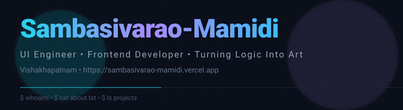

  

  
  
  

---

<b>$ whoami</b> — click to expand

Hi, I'm <b>Sambasivarao-Mamidi</b>, a UI Engineer and Frontend Developer based in <b>Vishakhapatnam</b>. I turn ideas into clean, working products — from pixel-perfect interfaces to robust full-stack applications.

<blockquote>
“I don’t just write syntax — I solve problems. Code is poetry written in logic.”
</blockquote>

**Currently navigating:** Full Stack Development  
**Goal:** Build applications that look beautiful and work flawlessly.

## 🧰 Tech Arsenal

### Frontend

  
  
  
  

### Backend & Database

  
  
  
  

### Tools

  
  
  

## 🚀 Featured Projects

| Project | Description | Tech | Link |
|---------|-------------|------|------|
| <b>A2Z-DSA-Sheet</b> | Step-by-step guide to mastering Data Structures and Algorithms from basic to advanced level. | Python | [View →](https://github.com/Sambasivarao-Mamidi/A2Z-DSA-Sheet) |
| <b>whatsapp-wrapped</b> | WhatsApp chat analysis and insights. | TypeScript | [View →](https://github.com/Sambasivarao-Mamidi/whatsapp-wrapped) |
| <b>Game_Station</b> | A gaming-focused frontend project. | CSS | [View →](https://github.com/Sambasivarao-Mamidi/Game_Station) |
| <b>Portfolio</b> | Personal portfolio website. | CSS | [View →](https://github.com/Sambasivarao-Mamidi/Portfolio) |
| <b>Attendance_Project-main</b> | Attendance management system. | JavaScript | [View →](https://github.com/Sambasivarao-Mamidi/Attendance_Project-main) |

## 📊 GitHub in Numbers

  
  

  

  <b>Turning logic into art.</b> 
  <i>$ exit 0</i>

